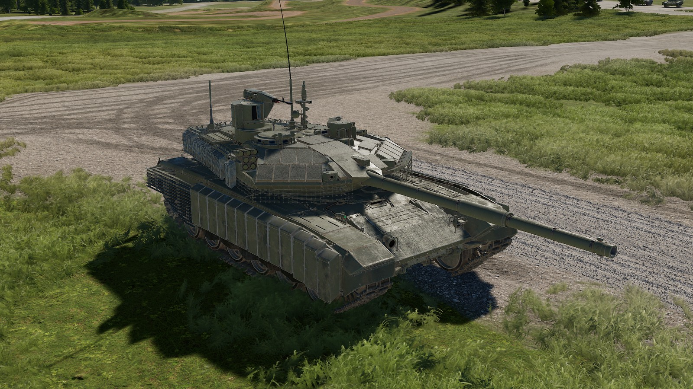
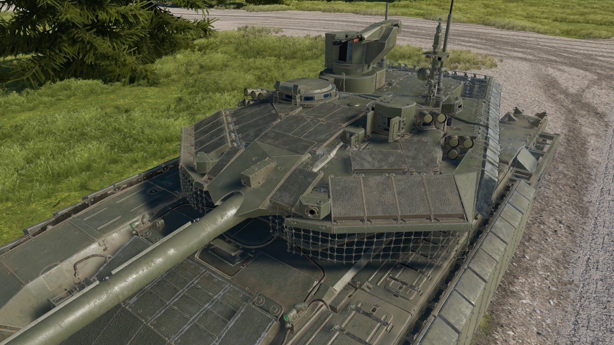
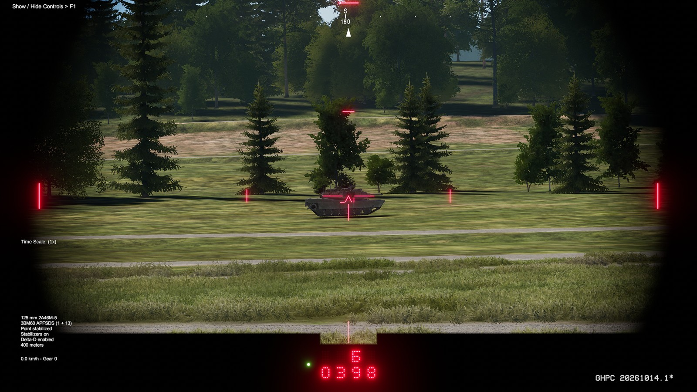
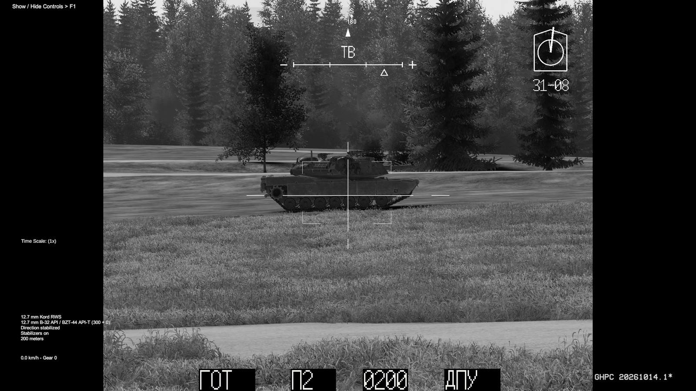
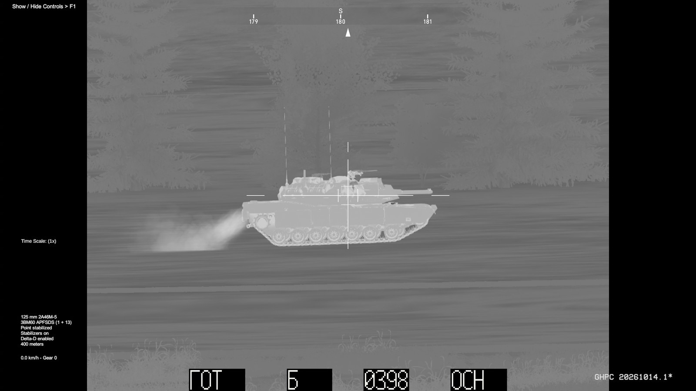
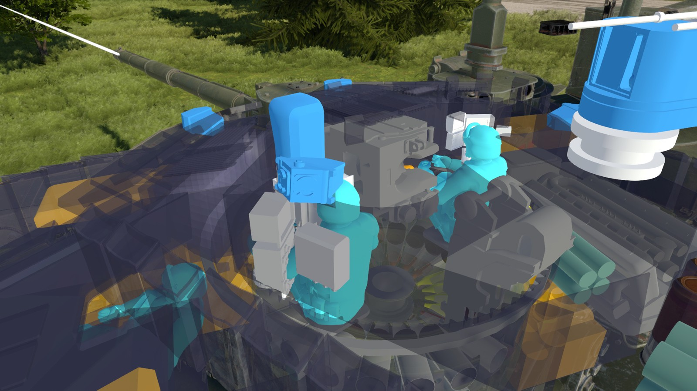
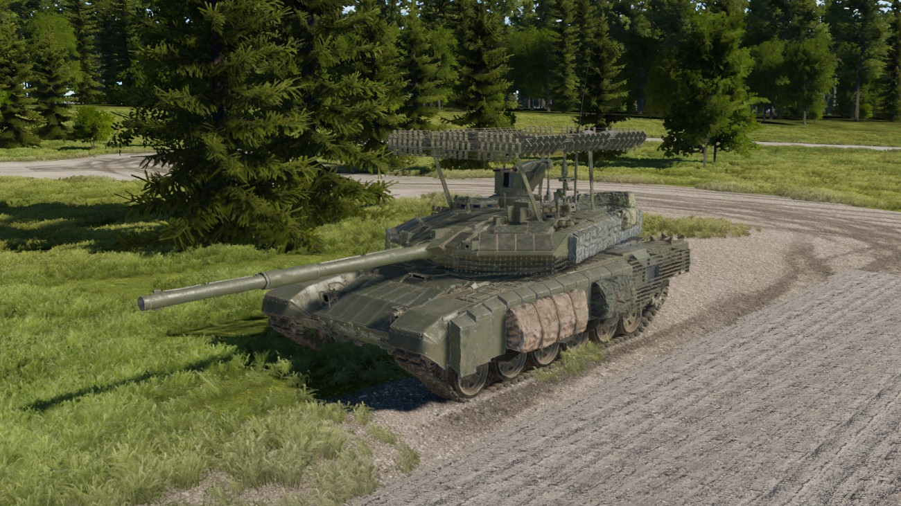

# T-90M for Gunner, HEAT, PC!



A modern tank for GHPC, with a detailed exterior, day and thermal sights, commander weapon control, and its own armor and damage model. Search through the panoramic sight, hand targets to the gunner, and review the results in native AAR.

**Preview** · GHPC 20261014.1 · MelonLoader 0.7.3

[Features](#features) · [Installation](#installation) · [Controls](#controls) · [Ammunition](#ammunition) · [Known limitations](#known-limitations) · [Credits](#credits)

## Features

- **A separate selectable vehicle.** Choose **T-90M** in mission vehicle customization, including Grafenwoehr. The default configuration adds its own entry rather than replacing every T-72.
- **Gunner optics.** Day and thermal channels, a backup PDT sight, laser ranging, stabilization, and ammunition-specific fire control.
- **Commander optics and control.** Panoramic TV and thermal channels, hold-to-designate turret slewing, and commander override for the main gun and coaxial machine gun.
- **Remote weapon station.** A stabilized 12.7 mm Kord with selectable 100/200 rpm firing rates.
- **Image-based target tracking.** Available in the gunner thermal sight and eligible commander sight magnifications. Tracking assists aim; you remain responsible for identification, ranging, and firing.
- **Protection and damage.** Modeled armor sections, reactive armor, crew and ammunition stowage, damageable sights and drives, and native after-action review (AAR) presentation.
- **Laser warning.** Audible and directional warnings, with a manual slew command when a precise bearing is available.
- **Exterior details.** Animated running gear and case-ejection hatch, plus cosmetic equipment variations.
- **Adjustable sight display.** Separate reticle/readout lighting and thermal contrast, exposure, gamma, and brightness controls with saved personal settings.



*Turret detail, including the sights, Kord mount, reactive armor, and stowage.*

### Gunner day sight



*Illuminated reticle and range display. Reticle, red readout, and green indicator brightness can be adjusted separately.*

### Commander and thermal views

| Commander TV | Gunner thermal |
| --- | --- |
|  |  |

*Commander TV channel and gunner white-hot thermal channel. Screenshots throughout this page were captured during development.*

### Damage review



*Inspect the vehicle's internal layout through GHPC's native AAR X-ray view.*

<details>
<summary>Exterior equipment variation</summary>



*One cosmetic equipment preset. A visible cage or net should not be read as a guaranteed protective effect.*

</details>

## Requirements

| Component | Supported configuration |
| --- | --- |
| Game | **GHPC 20261014.1**, Steam build **26382663** |
| Platform | Windows x64, Direct3D 11 |
| Mod loader | **[MelonLoader 0.7.3](https://github.com/LavaGang/MelonLoader/releases/tag/v0.7.3)** |

The game and loader must be installed separately. Other game or loader versions are unsupported. The mod checks specific game and loader files at startup; an update can require a compatible mod build even when the displayed game version looks similar.

## Installation

Use a complete mod package with the files shown below. GitHub's **Source code** download is not an installable mod.

1. Install the supported MelonLoader version for GHPC, then close the game.
2. Extract the mod package. Copy its **Mods** folder into the folder containing **GHPC.exe** (normally the game's **Bin** folder).
3. Merge with the existing Mods folder and replace matching T-90M files. Keep your other mods and personal settings.
4. Start GHPC and select **T-90M** in mission vehicle customization.

The result should look like this:

```text
Bin/
├── GHPC.exe
└── Mods/
    ├── T90MMod.dll
    └── T90MData/
        ├── model2.t90pak
        ├── armor-profiles.json
        ├── protection.json
        └── internal-layout.json
```

**Updating:** close the game and copy the complete new Mods folder over the existing installation. Keep any existing `Mods/T90MData/config.json` and `UserData/T90M` settings. A first installation runs with built-in defaults; a config file is not required.

**Removing:** close the game and remove only `Mods/T90MMod.dll` and `Mods/T90MData`. Back up `config.json` first if you want to keep custom controls. Personal sight settings remain in `UserData/T90M`.

**Going back to an older version:** close the game and restore all T-90M files from a matching, previously saved package. Keep the DLL, model pack, and armor/layout files together.

## Controls

These are the default T-90M shortcuts. GHPC's own controls still handle weapon selection, firing, laser ranging, zoom, and view switching; press **F1** for the game's control list. Custom game bindings can change the native actions below.

| Input | Action |
| --- | --- |
| **X** | Toggle image tracking in an eligible sight. Put the target under the aiming mark before engaging. |
| **V** | Toggle commander override for main-gun/coax control through the commander sight. |
| **Hold middle mouse** | From the commander sight or commander head view, slew the main turret toward the viewed direction. Release to end designation. |
| **Space** / native **Aim Override** | Use native designation; while an eligible precise laser warning is active, slew toward its bearing. |
| **F8** | Cycle Kord RWS rate: **П1 = 100 rpm**, **П2 = 200 rpm**. |
| **Ctrl + F9** | Open sight lighting / thermal image controls while using a supported sight. |

Commander designation is a direction handoff, not a firing command. Allow the gun to align and range the target before firing. Use the gunner station for the guided missile; missile firing is blocked during commander override.

Tracking depends on usable crew, sights, stabilization, and a sufficiently clear image. Wide commander views are excluded by default. After changing magnification or views, check the tracking indication and press **X** to designate again if tracking has ended. Do not assume the system can follow a target through smoke, complete cover, or a crossing vehicle.

The sight control window uses English. Russian letters on the modeled sight displays are intentional. Click **Save all** to keep display settings for the next session; **Restore** returns the selected tab to its saved values.

## Ammunition

The main-gun catalog offers six rounds across four selection categories. Use mission customization to select the available loadout.

| Category | Available rounds | Default allocation |
| --- | --- | --- |
| APFSDS | 3BM60, 3BM42-2 | 22 × 3BM60 |
| HEAT-FS | 3BK18M | 6 × 3BK18M |
| HE-FRAG | 3OF26, 3OF82 | 8 × 3OF82 |
| Guided missile | 9M119M1 | 4 × 9M119M1 |

The default loadout carries **40 rounds**, with **22 in the ready carousel**. The vehicle also has a 7.62 mm PKT coaxial machine gun and the 12.7 mm Kord RWS. Ammunition and protection values are tuned for GHPC; they are not certified real-world performance data.

**3OF82 time fuze:** set a valid FCS range before firing. The fuze timer is programmed at launch and stays fixed during flight, so it does not follow a moving target.

## Known limitations

- Tracking remains under development. Moving targets in TV imagery, abrupt maneuvers, stopping, obstructions, and reacquisition can produce losses or imperfect aim. Check the on-screen tracking state before firing.
- Verification has been performed on the development machine. Independent-PC, low-VRAM, and broad mod-combination testing remain incomplete; no minimum hardware or frame-rate guarantee is established.
- Some internal details, collision behavior, and AAR transparency remain approximations. Appearance alone does not establish collision or armor coverage.
- Laser warning supplies a bearing or sector, not the emitter's identity or distance. Smoke deployment remains manual.

## Troubleshooting and bug reports

**T-90M does not appear:** check the folder layout and the exact supported game/loader versions. Inspect `MelonLoader/Latest.log` for the first T-90M initialization error.

**Missing or damaged pack / unsupported file error:** copy the complete matching package again. After a game update, check whether the mod supports that build. Mixing a new DLL with older data files can prevent initialization.

**Tracking or commander control does not engage:** check the active sight, magnification, crew, stabilizers, and damage state. Close menus and return to the live vehicle view. If a trial build is involved, include its full version when reporting the problem.

For a useful report, include the game, loader and mod versions; mission; other installed mods; steps to reproduce; and a screenshot or short recording. Attach the relevant log after checking it for personal paths or other information you do not want to share publicly.

## Credits

- **Gunner, HEAT, PC!** — Radian Simulations LLC. A separately licensed game installation is required.
- **MelonLoader** — [LavaGang and contributors](https://github.com/LavaGang/MelonLoader).
- **T-90M exterior asset** — [lasha-george / GeorgeLV 3D, Fab listing](https://www.fab.com/listings/c9ce7d02-18e0-4e2d-aae0-5b0cf8fe8746), adapted for this project.
- Gameplay integration, vehicle systems, and additional authored parts — T-90M Mod Project.

Third-party assets remain subject to their applicable terms. Incorporating them in this mod does not grant permission to extract or redistribute them as standalone models or textures. This page grants no separate license to the code or incorporated assets.
