# T-90M for Gunner, HEAT, PC!


Adds the T-90M to GHPC with day and thermal sights, a commander's panoramic sight, a Kord remote weapon station, and custom armor and internal components. You can spot targets from the commander station, pass them to the gunner or take control of the main gun yourself. Hits and damaged components appear in GHPC's after-action review (AAR).

Version 1.0.3 · GHPC 20261014.1 · MelonLoader 0.7.3 recommended.

[Features](#features) · [Installation](#installation) · [Configuration](#configuration) · [Controls](#controls) · [Ammunition](#ammunition) · [Known limitations](#known-limitations) · [Measured performance](#measured-performance) · [Credits](#credits)

## Features

Select T-90M in mission vehicle customization. By default, it appears as a separate vehicle alongside the existing T-72s.

### Gunner day sight

The day sight has 4× and 12× magnification, laser ranging, and stabilization. The fire-control system calculates a firing solution for the selected ammunition. A backup PDT sight is also available.

[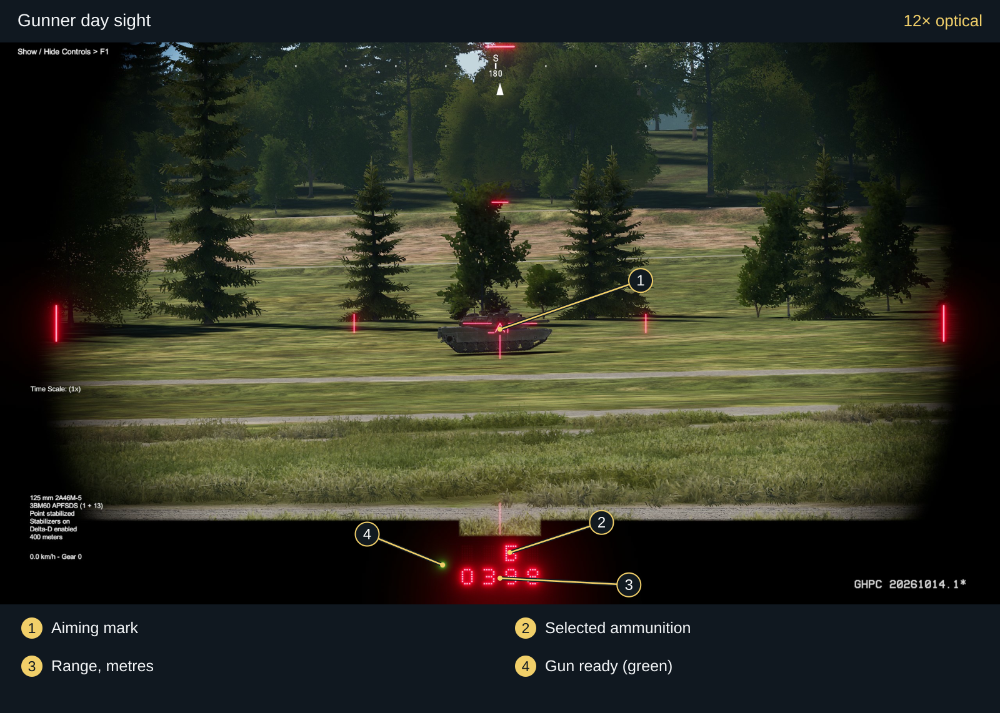](media/gunner-day-12x.svg)

<details>
<summary>4× view</summary>

[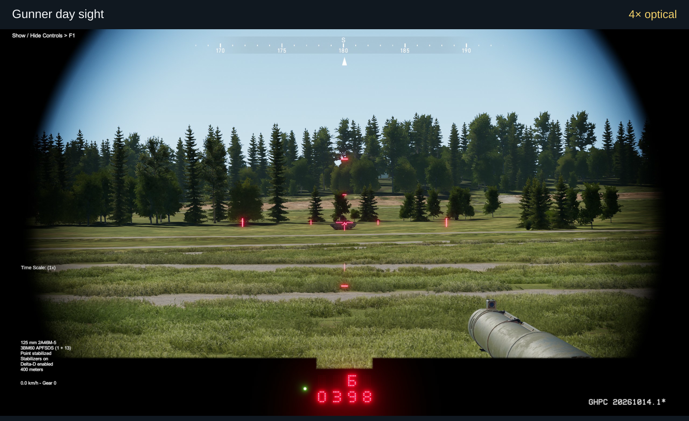](media/gunner-day-4x.svg)

</details>

The illuminated reticle, red readout, and green indicator have separate brightness settings in Ctrl + F9.

### Gunner thermal sight

The thermal sight has wide and narrow fields of view, plus 2× electronic enlargement of the narrow view. Both white-hot and black-hot are available. Start a new automatic track in the narrow or electronically enlarged view.

[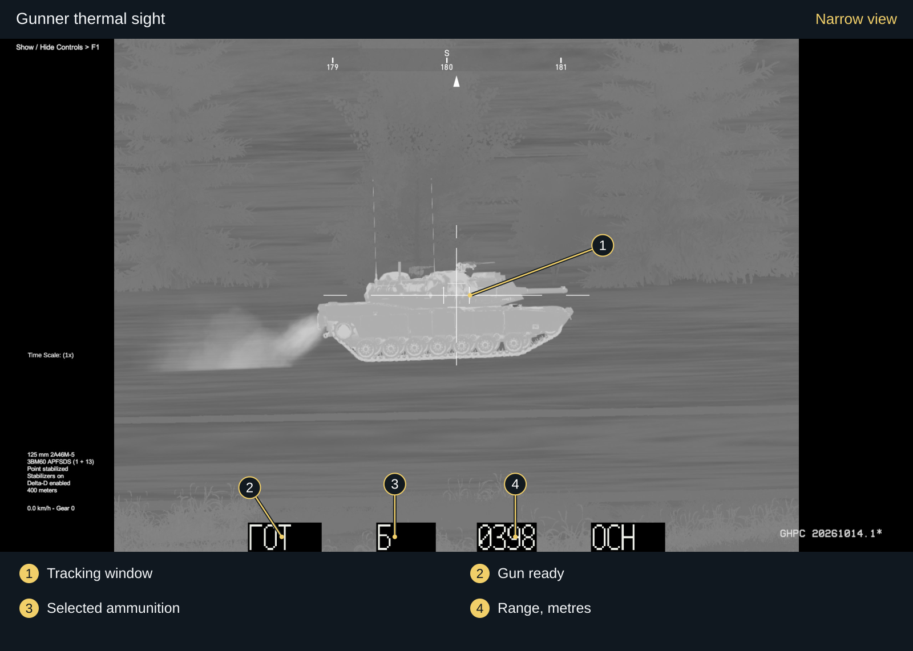](media/gunner-thermal-narrow.svg)

<details>
<summary>Wide view and 2× electronic enlargement</summary>

[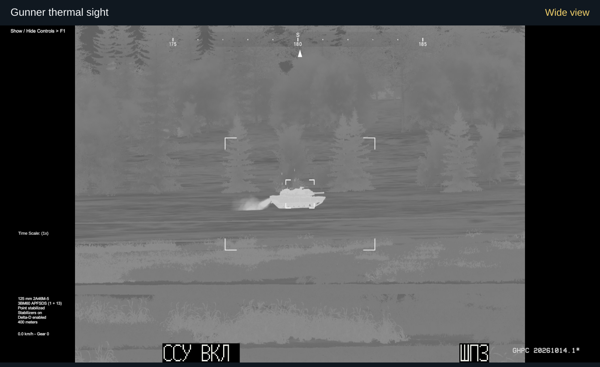](media/gunner-thermal-wide.svg)

[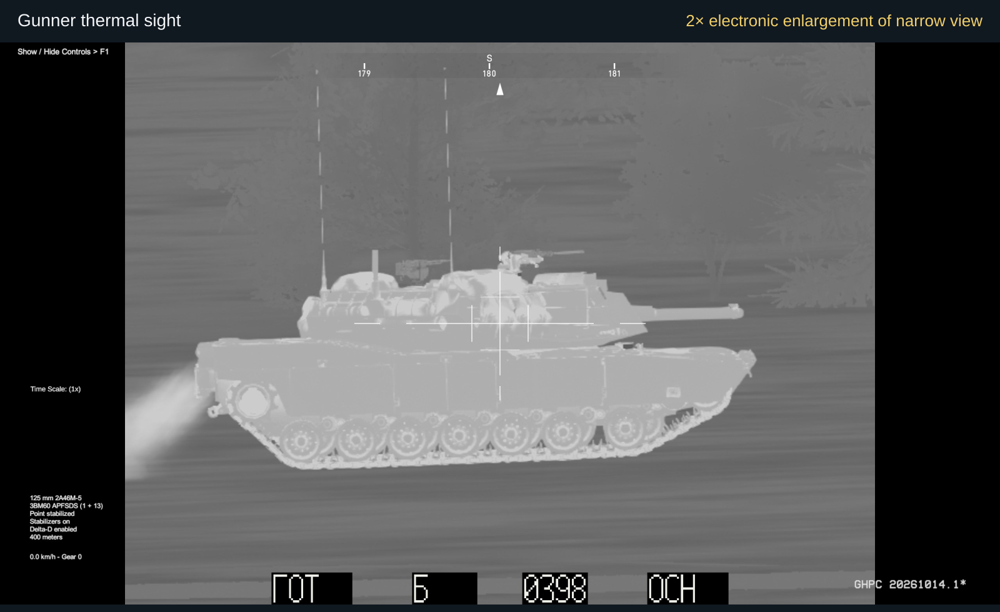](media/gunner-thermal-digital.svg)

</details>

Thermal contrast, exposure, gamma, and brightness are adjustable in Ctrl + F9. Save your settings to keep them between sessions.

Both thermal sights refresh at 25 fps by default, independently of the game's frame rate. Set `LimitThermalTo25Fps` to `false` in [config.json](#configuration) if you prefer a smoother view.
Automatic tracking capture remains capped at 25 Hz.

### Commander TV sight

The panoramic TV sight has 2×, 4×, and 12× magnification. Hold the middle mouse button to turn the main turret toward where you are looking. Commander override lets you fire the main gun and coaxial machine gun through the commander sight.

[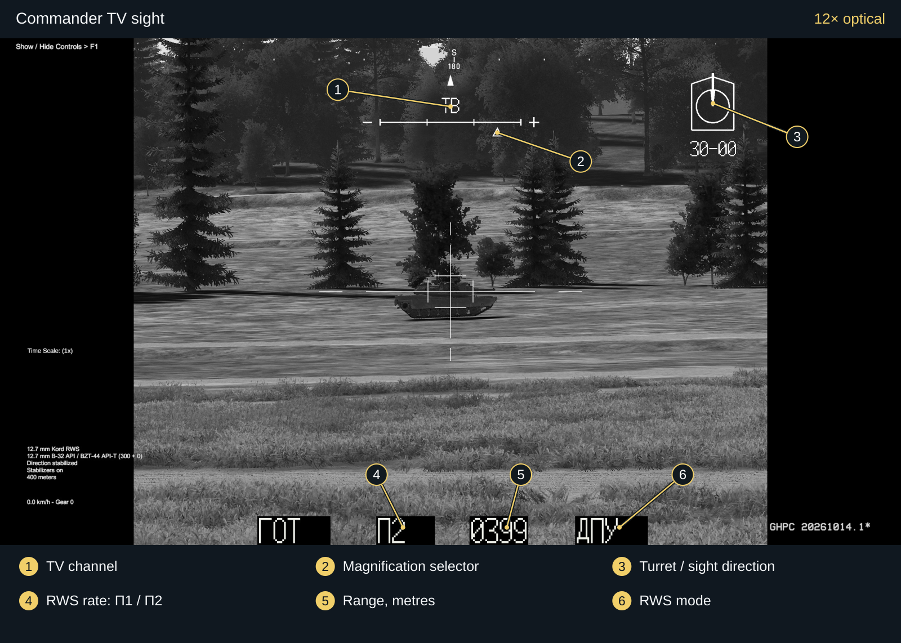](media/commander-tv-12x.svg)

<details>
<summary>2× and 4× views</summary>

[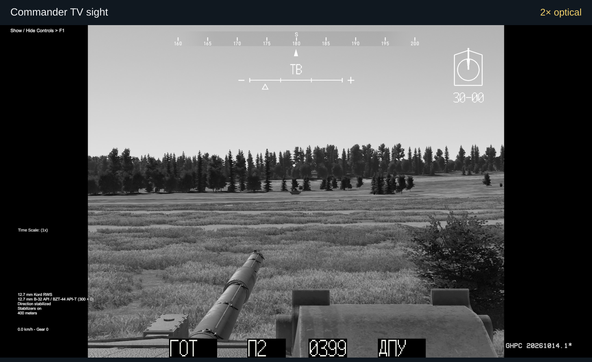](media/commander-tv-2x.svg)

[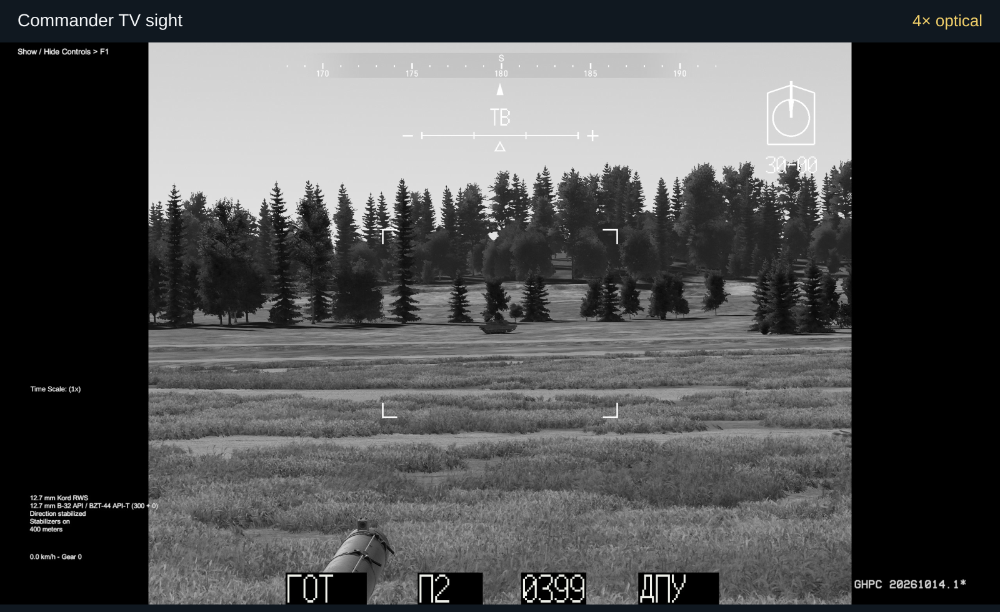](media/commander-tv-4x.svg)

</details>

The stabilized 12.7 mm Kord remote weapon station can fire at 100 or 200 rpm. Its selected rate appears as П1 or П2 at the bottom of the commander display.

### Commander thermal sight

The thermal channel has 2×, 4×, and 12× optical magnification, with an additional 20× electronic view. The 20× setting enlarges the 12× sensor image. Commander override keeps your selected thermal magnification.

[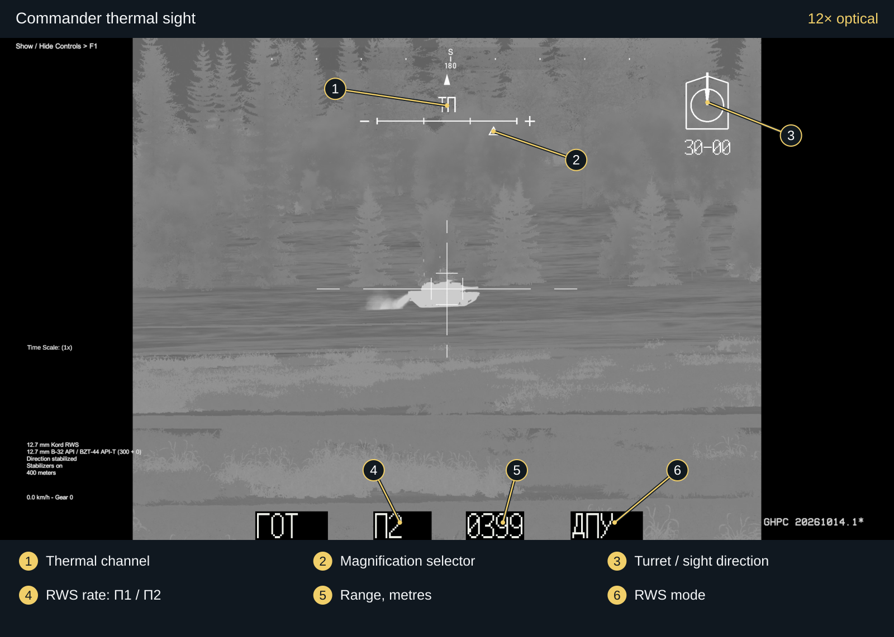](media/commander-thermal-12x.svg)

<details>
<summary>2×, 4×, and 20× views</summary>

[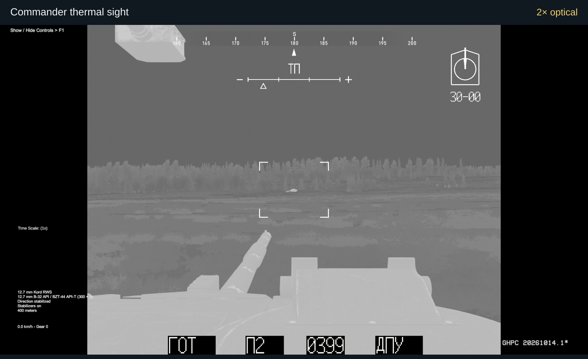](media/commander-thermal-2x.svg)

[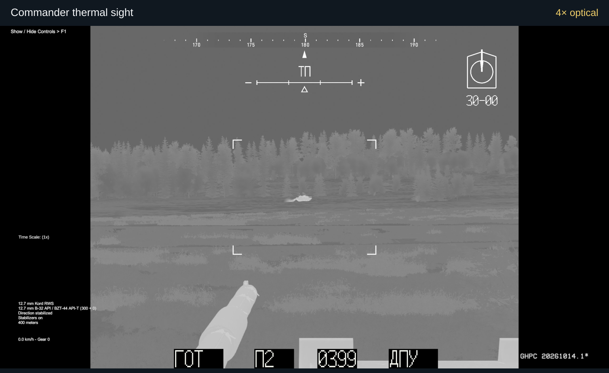](media/commander-thermal-4x.svg)

[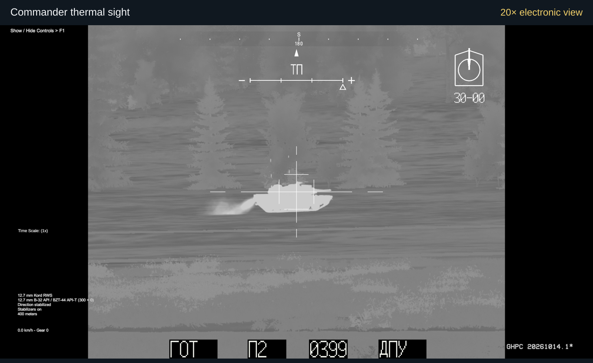](media/commander-thermal-20x.svg)

</details>

### Automatic tracking

Automatic tracking follows a selected area of the sight image. It works in the gunner thermal sight and in both commander channels. By default, new locks are available in the gunner's narrow thermal views and the commander's 12× or 20× views. TV tracking uses the TV image; thermal tracking uses the thermal image. The tracker never reads the target vehicle's position or velocity from the game. You still choose the target, range it, and fire.

An established track can continue through magnification changes within the same sight, including a change to a wider view. The tracker rechecks the target at the new scale and may briefly show Coasting. If the track ends, zoom in and press X to select it again.

#### Reading the tracking indicator

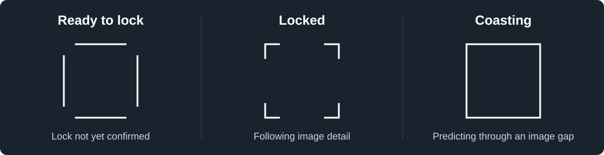

- Ready to lock: four side bars with open corners. Aim at the target and press X. This shape stays on screen while the tracker confirms the lock.
- Locked: four L-shaped corners. The tracker is following the selected image detail.
- Coasting: a closed box. The tracker has lost a reliable image match and is predicting motion while trying to find it again. It releases the track if five seconds pass without a reliable match.

The shapes are enlarged here. They appear black in black-hot thermal mode and white otherwise. "Ready" only means there is enough image detail to try a lock; the tracker does not identify vehicles or distinguish friend from foe.

### Armor and damage review

The armor, ERA, crew, and ammunition stowage use GHPC's damage system and appear in AAR. The gunner and commander have separate fire-control computers that can be damaged independently, as can the sight heads and traverse and elevation drives.


AAR keeps track of which ERA blocks each shot detonated. Those blocks appear in red for that shot and disappear from the X-ray view for subsequent shots. Going back to an earlier shot restores the ERA as it was then. The hull inner side ERA follows the same rule, although its exterior casings remain in place and can still be hit after detonation.

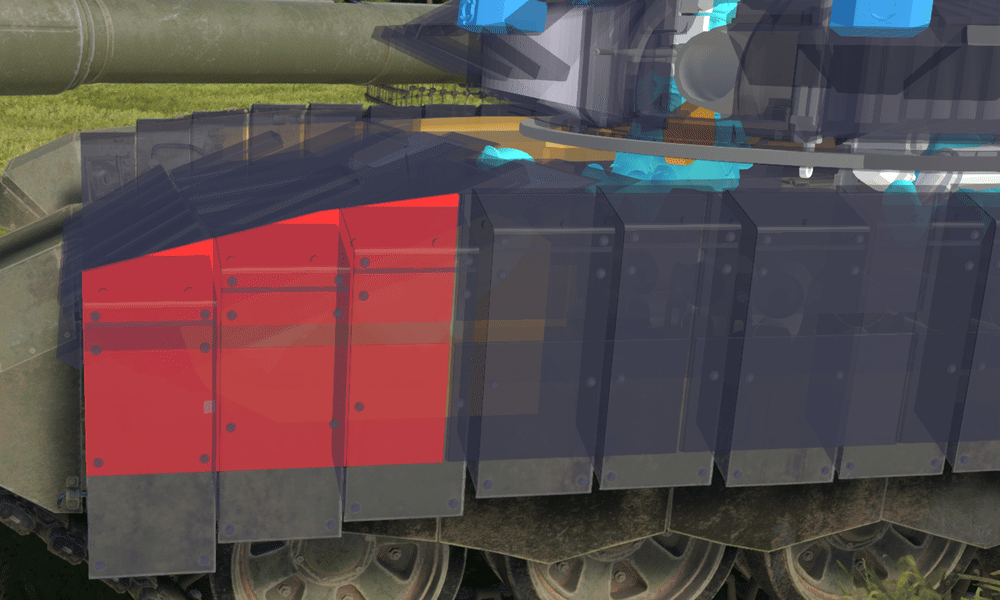

### Laser warning and smoke

Four laser-warning sensors detect laser illumination. The two forward sensors give a precise bearing; the two wider-angle sensors give an approximate sector. A warning sounds and a red marker or sector appears on the compass. When a precise warning is active, Space turns the turret toward it, taking priority over a normal commander designation. Each sensor can be damaged.

Laser warnings are active only on the T-90M you are controlling. They give you a direction, but cannot identify the source or tell you its range. You deploy smoke manually.

The 3D17 smoke grenades quickly form a dense screen that obscures day and thermal views, including both thermal polarities. The cloud gradually disperses.

### Exterior details


The exterior includes animated running gear and a working case-ejection hatch. Cosmetic equipment varies between vehicles.

<details>
<summary>Exterior equipment variation</summary>


One of the equipment presets, with the roof cage fitted. The presence of a cage or net does not necessarily mean it provides armor protection.

</details>

## Requirements

You need Gunner, HEAT, PC! and MelonLoader installed to use this mod.

| Component | Supported configuration |
| --- | --- |
| Last tested game | GHPC 20261014.1 |
| Platform | Windows x64, Direct3D 11 |
| Mod loader | 0.6.1 or newer; [0.7.3 recommended](https://github.com/LavaGang/MelonLoader/releases/tag/v0.7.3) |

Other game builds can run the mod, with a warning in `MelonLoader/Latest.log`. MelonLoader versions below 0.6.1 show an update notice and stop loading the mod. This release was checked on MelonLoader 0.7.3; earlier builds were also tested on 0.6.1 and 0.7.2. Other builds above the minimum can run it subject to the same startup checks and are marked as untested in the log.

At startup, the mod checks the files it needs, where assemblies were loaded from, and the game code and assets it uses. These checks cannot catch every possible incompatibility, so some game updates may still need a mod update.

### Test PC

Development testing uses an AMD Ryzen 7 9800X3D, an NVIDIA GeForce RTX 5080, and 32 GB of RAM at 2560 × 1440. These are the test machine's specifications, not minimum requirements. Frame rates vary with the mission, the number of vehicles, and graphics settings.

## Installation

These instructions are for the complete mod package containing the files below. GitHub's Source code download cannot be installed as a mod.

1. Install a supported MelonLoader version for GHPC, then close the game.
2. Extract the mod package. Copy its Mods folder into the folder containing GHPC.exe, normally the game's Bin folder.
3. Merge with the existing Mods folder and replace matching T-90M files. Keep your other mods and personal settings.
4. Start GHPC and select T-90M in mission vehicle customization.

Check that the files are in these locations:

```text
Bin/
├── GHPC.exe
└── Mods/
    ├── T90MMod.dll
    └── T90MData/
        ├── model2.t90pak
        ├── armor-profiles.json
        ├── protection.json
        └── internal-layout.json
```

### Updating

Close the game and copy the new package's Mods folder over the existing installation. Keep your `Mods/T90MData/config.json` and `UserData/T90M` settings. The mod adds missing settings automatically and creates a default config on first launch.

### Removing the mod

Close the game and remove only `Mods/T90MMod.dll` and `Mods/T90MData`. Back up `config.json` first if you want to keep custom controls. Personal sight settings remain in `UserData/T90M`.

## Configuration

The mod creates `Mods/T90MData/config.json` on first launch. When updating, keep your existing file: missing settings are added automatically, and your values are preserved. Close GHPC before editing the file.

You can change key bindings, enable or disable individual features, turn off the thermal refresh limit, and set the ammunition carried in each location. Restart GHPC after saving your changes.

For a custom tracking shortcut, set `VideoTrackingKey` to an unused keyboard key such as `F7`. `VideoTrackingModifier` can add a held modifier. Invalid or reserved bindings fall back to X for that session; if X is also assigned to another T-90M control, the tracking shortcut is disabled. The log explains the fallback, and your saved values remain unchanged. See the configuration reference for allowed modifiers and reserved keys.

## Controls

The shortcuts below use the default bindings. Weapon selection, firing, ranging, zoom, and view switching use GHPC's controls; press F1 to see those. If you have rebound a game action, use your chosen key for it.

| Input | Action |
| --- | --- |
| X | Toggle automatic tracking in a supported sight. Aim at the target before pressing. |
| V | Toggle commander override for main-gun/coax control through the commander sight. |
| Hold middle mouse | Turn the main turret toward where you are looking from the commander sight or head view. Release to stop designation. |
| Space / native Aim Override | Turn toward the commander's designation, or toward a precise laser warning when one is active. The laser warning takes priority. |
| F8 | Cycle Kord RWS rate: П1 = 100 rpm, П2 = 200 rpm. |
| Ctrl + F9 | Open the sight lighting and thermal image settings while using a supported sight. |

Commander designation turns the turret without firing. Let the gun align and range the target before firing. Guided missiles must be fired from the gunner station; they cannot be fired during commander override.

Tracking needs functioning crew and sights, stabilization, and a clear enough image. Wide views can carry an existing track but do not accept new locks by default. Check the indicator after changing magnification or views. Smoke, cover, or a vehicle crossing in front of your target can break the lock or pull it onto something else.

The settings window is in English; the Russian markings on the sights are intentional. Click Save all to keep your settings for the next session. Restore returns the current tab to its saved values.

## Ammunition

Choose from six main-gun rounds in mission customization:

| Category | Available rounds | Default allocation |
| --- | --- | --- |
| APFSDS-T | 3BM60, 3BM42-2 | 22 × 3BM60 |
| HEAT-FS-T | 3BK18M | 6 × 3BK18M |
| HEF-FS-T | 3OF26, 3OF82 | 8 × 3OF82 |
| Guided missile | 9M119M1 | 4 × 9M119M1 |

The default loadout is 40 rounds: 22 in the autoloader carousel, 8 in the hull reserve, and 10 in the external reserve. `DefaultAmmoLoadout` lets you set each category's count in each location. Total loads of 1 to 40 rounds are allowed, including empty individual locations; each location must stay within its own capacity. Invalid allocations fall back to the default 40-round loadout and are reported in the log.

The tank also carries a 7.62 mm PKT coaxial machine gun and the 12.7 mm Kord RWS. Ammunition and armor values are tuned for GHPC and are not verified real-world performance figures.

Set a valid range in the fire-control system before firing 3OF82. Its time fuze is set at launch and does not adjust during flight, even if the target moves.

## Known limitations

- Small targets, sudden turns, and clutter around the aiming point can cause tracking to drift or lose the target. TV tracking is particularly sensitive to background detail. Check the indicator before firing.
- Testing on other PCs, GPUs with less VRAM, and combinations of mods is still incomplete. Minimum hardware requirements have not been established.
- Physical collision shapes are simplified, and some cosmetic fittings have no separate armor protection.

## Troubleshooting and bug reports

### T-90M does not appear

Check the folder layout and your MelonLoader version. A different game build alone does not block the mod. Look for the first T-90M initialization error in `MelonLoader/Latest.log`.

### Missing or damaged pack / unsupported file error

Copy all files from the same mod package again. Mixing a new DLL with older data files can stop the mod from loading. If this started after a game update, check for compatibility reports or a mod update.

### Tracking or commander control does not engage

Check the active sight, magnification, crew, stabilizers, and damage state. Close menus and return to the live vehicle view.

For a bug report, include your game, MelonLoader and mod versions, the mission, other installed mods, and what you did before the problem occurred. A screenshot or short recording helps. Attach the log, but check it first for personal file paths or anything else you do not want to share.

## Measured performance

With 16 T-90Ms in the training area, average frame rates ranged from **153 to 155 FPS stationary** and **67.7 to 68.9 FPS moving** at about 2.7 m/s. These measurements come from version 0.10.115 on a Ryzen 7 9800X3D, RTX 5080 and 32 GB of RAM at 2560 × 1440.

Each range covers two 20-second runs in an external daytime view with AI disabled. Combat and sight views can give different results. Version 0.10.116 was tested for mission transitions separately.

## Credits

- Gunner, HEAT, PC! by Radian Simulations LLC.
- MelonLoader by [LavaGang and contributors](https://github.com/LavaGang/MelonLoader).
- Exterior model by [lasha-george / GeorgeLV 3D, Fab listing](https://www.fab.com/listings/c9ce7d02-18e0-4e2d-aae0-5b0cf8fe8746), adapted for this mod.
- Gameplay integration, vehicle systems, and additional parts by the T-90M Mod Project.

## License and assets

Third-party assets are covered by their own licenses. Permission to use this mod does not include permission to extract or redistribute those models and textures on their own. This README does not grant a license to reuse the mod's code or assets.
